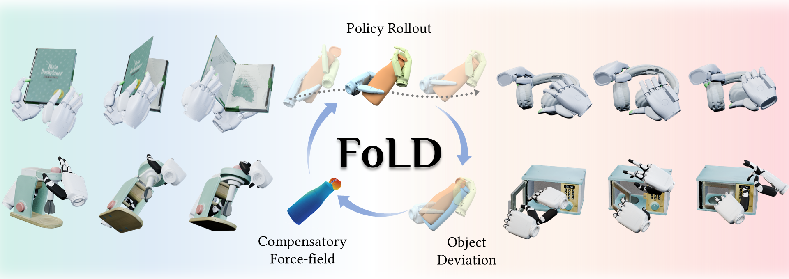

# FoLD: Force-field-guided Learning for Dexterous Manipulation

<p align="center">
  <strong>Haowei Shen<sup>1</sup>, Tingai Li<sup>1</sup>, Yumeng Liu<sup>1,*</sup>, Wenyuan Guang<sup>2</sup>,<br>
  Xuanze Yang<sup>1</sup>, Qing Fang<sup>1</sup>, Kai Xu<sup>2,3</sup>, Ligang Liu<sup>1</sup>, Ruizhen Hu<sup>4</sup></strong>
</p>

<p align="center">
  <sup>1</sup>University of Science and Technology of China<br>
  <sup>2</sup>Institute of AI for Industries, Chinese Academy of Sciences<br>
  <sup>3</sup>Jiangsu Key Laboratory of AI for Industries<br>
  <sup>4</sup>Shenzhen University<br><br>
  <sup>*</sup>Corresponding author: Yumeng Liu (<a href="mailto:lym29@mail.ustc.edu.cn">lym29@mail.ustc.edu.cn</a>)
</p>

FoLD is a pipeline for dexterous manipulation of articulated objects. This repository contains the training and evaluation code used in our work.

[Paper (arXiv:2609.33551)](https://arxiv.org/abs/2609.33551) · [Project page](https://gghgghgghgg.github.io/FoLD-project-page/)


## Installation

We recommend Linux with Python 3.10. From the repository root:

```bash
conda create -n fold python=3.10 -y
conda activate fold
python -m pip install --upgrade pip

python -m pip install torch==2.5.1 torchvision==0.20.1 \
  --index-url https://download.pytorch.org/whl/cu124
python -m pip install -r requirements-runtime.txt
python -m pip install -r requirements-dev.txt

export PYTHONPATH="$PWD/rl_games:$PWD${PYTHONPATH:+:$PYTHONPATH}"
export SETUPTOOLS_USE_DISTUTILS=stdlib
export WANDB_MODE=offline
```
See the full [documentation](docs/ENVIRONMENT_SETUP_AND_REPRODUCTION.md) for additional installation instructions for dexterous hand. 
## Example

After installing the required data and models, run the Box Stage 1 example from the repository root:

```bash
bash training/train_stage1_box_example.sh
```

The [training examples](training/README.md) list the Stage 1, force-field encoder, and Stage 2 commands.

## Documentation

See the [environment setup and reproduction guide](docs/ENVIRONMENT_SETUP_AND_REPRODUCTION.md) for data placement, preprocessing, training, and evaluation. Asset sources and licensing notes are listed in [External Assets](docs/EXTERNAL_ASSETS.md).
